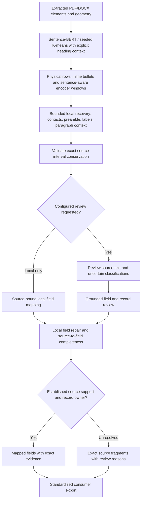

# Local detection, review and source-to-field completeness

The pipeline classifies source text before deciding whether it can be associated
with a particular employer, project or qualification. A known section with an
unknown record owner is different from an unknown section. Neither condition is
resolved by inventing a name, date or association.

## Execution flow



The reviewed sections endpoint reviews all source spans, including source elements
and remaining unassigned text. A direct `review_fields=true` mapping request can
bypass that endpoint; it now performs a classification preflight when meaningful
unassigned text or an explicit section-label contradiction is present, unless a
completed/partial section review is already recorded. Ordinary local mapping makes
no provider calls.

## Local improvements

- Inline bullet glyphs establish item boundaries. Hyphens inside dates and names
  do not. Long token windows prefer complete sentences when there is an appropriate
  boundary inside the encoder window; exceptionally long sentences still require
  bounded word-safe windows.
- Additional publication and volunteering heading variants reuse the existing
  section families, local model and field registries.
- Opening contact values can be recognized beside decorative PDF icons without
  changing any returned character. Opening names use unique title/contact context
  or dominant typography. Reference contacts are not searched as candidate contacts.
- Fragmented names are joined only across actual source word boundaries. Joining
  typography runs cannot silently append an adjoining job-title token to a name.
- Explicit career-summary introductions before employment/section boundaries can
  establish summary context for their contiguous preamble prose. Hiring requirement
  wording does not establish a candidate summary.
- Category-specific labels recover projects, education, certification and other
  recognizable source rows. Cross-column responsibility ownership is not inferred
  merely from reading order.
- Leading/trailing fragments of a paragraph with one established section context
  can recover that section. This does not establish a missing employer or project
  owner. Newly proposed employment groups require identity/header evidence; action
  sentences containing words such as "solutions" or "architect" cannot become a
  new company/job just because they resemble organization/title vocabulary.
- Existing record IDs and source membership are preserved during local recovery.
  Unrelated jobs/qualifications are not rebuilt to accommodate one recovered span.
- Explicit certification detail rows join an adjacent same-page/lane credential
  card. A new certification name starts a new card; unlabelled organizations are
  not guessed as issuers.

Implementation: `local_completion.py`, `preamble_recovery.py`, `contact_sections.py`,
`resume_sections.py`, `resume_structure.py`, and `section_recovery.py`.

## Field mapping improvements

`record_subfields.refine_record()` supplements responsibilities instead of replacing
previous/remaining duties when a labelled responsibility row is found. Commas and
semicolons within prose do not become fabricated separate duties. A supplied entry
with no precomputed field hints can still map action clauses when its source-local
employer and role are established, or an explicit source role anchors the record.
A missing freelance/client employer remains missing rather than being invented.

`project_fields.project_fields()` separates project names, description prose and
labelled role/tool/URL fields. It preserves physical-row continuations without
inserting newlines into the middle of one extracted source element. A scalar
project description must remain source-contiguous; disjoint pieces are retained
for association review rather than stitched into an unsupported quotation.

The shared source date-range recognizer supports full ISO day dates, day/month-name
forms and numeric month/year forms. Education mapping retains explicit month
precision rather than reducing a provided month/year to a year alone.

The optional field reviewer can merge/split provisional record proposals from its
complete supplied context. It receives existing logical blocks, registry slots,
local record hints and exact completeness/overlap targets. These are advisory hints,
not trusted extracted facts. Foreign citations, invented strings, overlapping record
ownership and invalid source intervals remain rejected by existing validators.

## Completeness ledger

`mapping_completeness.mapping_completeness()` runs on local mapping and committed
reviewed mapping before the final response. Its metadata is
`meta.completeness_check`:

- `source_intervals_valid`: source-to-block inventory passed deterministic validation.
- `mapped_intervals`: source ID, element index, exact start/end offsets and target field.
- `unmapped`: remaining meaningful source intervals, original text, section, local
  reason and why a section/record/field association has not been established.
- `conflicting_field_overlaps`: unrelated fields claiming overlapping source text.
- `heading_source_ids` and `non_content_artifacts`: explicitly accounted structure.
- `all_meaningful_content_accounted_for`: every meaningful fragment has a field
  claim or an explicit unresolved outcome.
- `all_meaningful_content_mapped`: false when meaningful fragments or field conflicts
  remain. This does not certify semantic accuracy even when true.

A broad evidence quote does not consume all quoted text: only actual field values
consume intervals. Repeated literal occurrences are allocated to compatible source
positions where possible, avoiding false conflicts from repeated names/role words.
The inspector consumes this ledger when available; a broad quote cannot hide
unmapped words in the UI. Skill union aliases, summary numeric evidence and date-range/subdate evidence have
explicit compatible-overlap rules. Unrelated field overlap remains reviewable.

Page separators, whitespace and source-supported footer markers remain in source
provenance, but do not become unresolved candidate information or unnecessary
human-review warnings. Four-digit graduation years are not treated as page numbers.

## Review cost and failure behavior

Classification preflight and field mapping share the existing bounded request budget
inside a mapping request. `meta.provider_call_summary` reports preflight, field and
total calls for that request. Legacy `provider_calls`/`field_review.provider_calls`
semantics remain intact. Separate sections/mapping HTTP requests retain their
existing per-request budgets, and completed section review prevents duplicate
classification preflight.

Provider failure, abstention or budget exhaustion retains source-bound local output
and review findings. An already-reviewed abstention is not retried indefinitely. If no classified section
exists, field review is explicitly not applicable (`no_classified_sections`), not
reported as complete.
Conflicts/unmapped content affect mapping and downstream usability flags. No review
result is described as independent factual verification.

## Verification

Run `tests/test_block_completion.py` for focused general regressions. Existing
source/citation, structural-record, layout, local-model, mocked-provider and API
suites remain in use.

Replay cached extraction with the pinned local model, without network/provider calls:

```bash
/home/zoyaharmain/venv312/bin/python scripts/replay_detection_accuracy.py \
  --run reports/resume-batch-repairs-20261027/final-local \
  --output /tmp/new-block-replay
```

Use `--code-root` to compare an isolated prior source tree. Compare two outputs with
`scripts/compare_detection_replays.py`. Output locations must be new.

The ten-resume evaluation replays existing extraction for six DOCX and four PDFs;
it does not redo OCR or establish a semantic accuracy percentage. Known section
recovery, source conservation, field separation, ownership and call-budget behavior
are tested independently. Ambiguous employer/project association and damaged source
text can still require grounded review or human verification.

## Desired-role sections and bounded processing reuse

Explicit target/desired-role headings and bounded contiguous title/preferences
lists are recovered into personal_information with source evidence. Existing
contact.target_role and contact.work_preferences fields distinguish them from
employment, current professional title and residential location. Recovery stops
at page, lane, section/date boundaries and bounded source windows; wide rows can
continue a same-page section. Uncertain boundaries remain reviewable.

Encoder vectors for repeated exact text use an in-process bounded cache; source
ownership and schema mappings are recomputed each time. Grounded field review
packs modest complete sections together instead of forcing one call per repeated
category, retaining input/context budgets and per-batch validation/fallback.

## Complete target lists after field review and parallel mapping

Field review can select a valid literal first title while omitting the rest of an
explicit desired-role list. After accepting the provider envelope, recover the
complete uniquely headed source list and its preferred geographic scope using
exact citations, then run the normal hierarchy/source validation again. This
keeps data.contact.target_role and the corresponding subschema value identical;
no roles or locations are inferred. The repair is recorded in field-review metadata.

Production settings use DEEPSEEK_FIELD_WORKERS=3 by default (supported range 1–4).
Complete independent field-review batches run in bounded windows. Reserve the
shared request budget before submitting each paid request, consume results in
source order, and retain validated batches when another batch fails. Already
in-flight requests can finish after a sibling fails; later windows are not sent.
Explicit ReviewSettings defaults to one worker for deterministic custom callers.
Field-review metadata reports batch_count, batch_workers and processing_seconds.

Paid POST completions no longer automatically retry HTTP errors or transport
timeouts. Read-only model/connection checks retain their transient retries.
Existing bounded validation-repair attempts remain separate and budgeted.

## Compact field-review responses

Stage 3 requests compact_fields_v1: populated literal values and their owning
source IDs, without repeated quotations or empty field arrays. The server rebuilds
exact citations from those declared source blocks and then runs the same public
schema, source, ownership and completeness validators. Unreported empty fields
remain unmapped; they are never presumed absent. Legacy verbose responses remain
supported. A version marker is required for expansion, so malformed legacy
responses do not silently acquire missing fields.

Logical-record prompts retain record IDs, block memberships and source structure;
source text is supplied once in the source-block inventory. Three default workers
allow a typical three-batch assignment to run in one bounded window. No candidate
source data is dropped or inferred by these response-size optimizations.

## Combined education and certification sections

An explicit shared heading supplies context for both families without becoming an
entity. Recover physical rows from source PDF offsets when bottom-of-page elements
merge qualifications, certificate titles or date ranges. Classify degree and
credential rows independently, then use unique row alignment for date ownership.
Heading fragments and standalone dates are not certificate identities. Orphan or
ambiguous dates remain retained for review. Dotted-degree lookup normalization
preserves word boundaries; source spelling and punctuation remain unchanged.

## Word paragraph evidence and dated record headers

Word extraction retains source paragraph/run offsets, bold flags and original
hyperlink relationships without replacing visible text. Generic dated-header
parsing can separate an undelimited role/employer line in an entry's opening
region. First-person sentence grammar cannot validate an employer or role merely
because the value is quoted literally. Strong separately dated records can be
restored after provisional review merges them.

Date-first education starts a new qualification when the following source title
and institution establish a record. Preserve exact title, major, institution and
completion month; do not invent start dates or qualification level. Short named
Word project bullets are distinct from action prose and subfield labels.

Opening profile URLs retain raw source quotes, including supported paragraph
continuations. Only bounded URI whitespace repairs occur during standardization,
with original/normalized values in applied warnings. Hidden hyperlink targets have
explicit relationship provenance. Truncated targets, bare labels, references and
technology names do not establish candidate profile URLs.
