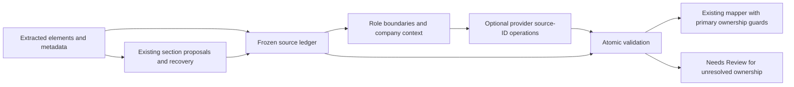

# Source ownership and structural repair

Raw extraction remains in `text_extraction_service.extract_text`; this change does not rewrite extracted elements or their metadata. Section detection, local recovery, section review and schema mapping remain the existing pipeline. `source_ownership.finalize_ownership` adds a final ownership pass to both section routes and the direct mapper. The local-only route never calls a provider.



`source_ownership.snapshot` checks complete source interval coverage and freezes source text, Unicode offsets, page, original type, geometry, normalized bounding box where available, extraction reading order and lane. Every source interval has an `e{element}:{start}:{end}` ID. A SHA256 binds the extraction, including source metadata. IDs are stable for an identical extraction and interval; an extraction change invalidates annotations. Extraction order is recorded as such, rather than presenting an inferred order across ambiguous columns as a fact.

The immutable ledger and mutable assignments are separate. Each interval has at most one primary section and record owner. Record IDs derive from their source anchors. Hierarchy and employer-parent references appear in `metadata.source_ownership`; existing section/entry response types remain usable. Existing source block splits remain views of the original extraction. Repair cannot generate arbitrary text, offsets or source IDs.

Local role splitting requires repeated role evidence separated by responsibilities. Titles, headers and footers are weak upstream signals. Close role headers no longer merge merely because of vertical proximity, and a geometric tolerance cannot pull a preceding responsibility into a later role in the same lane. Dates do not sort jobs or infer missing periods. A continuation can retain its role across pages.

`employer_context.valid_employer_context` permits automatic company-only context from a standalone source employer heading within the same lane/scope. A combined company/title/date header establishes one job, not an implicit parent for every subsequent job. An explicit validated `link_employer` operation can cite its company fact for another role. Company context is excluded from the source text used to refine other fields; dates, titles, clients, technologies and responsibilities never inherit through it. `source_validation` and `subschema_validation` independently validate these context citations. Unsupported assignments remain Needs Review.

`schema_mapping.map_schema` no longer copies Projects text into the only Experience record or uses a preceding record's closure to widen evidence. Incomplete source identities remain reviewable; unsupported fragments remain in source residuals rather than becoming invented job facts. Generic skill list labels and discipline headings cannot establish employer/title evidence by themselves.

## Provider operations

The configured DeepSeek settings and transport are reused; no additional credentials or provider service are introduced. The remote section route can make one additional bounded structural-review call. Direct mapping and the local route remain offline. Input size, conservative UTF-8 token upper bound, context budget and prior provider-call budget are checked. Provider results are provisional, never independent ground truth.

Operations are atomic:

- `create`: canonical repeated section and existing source IDs; derive the new record ID from its earliest source ID. Entity fields require separate explicit assignments.
- `split`: existing record plus one of its source IDs; both resulting records must be nonempty.
- `merge`: existing records with one section and one established source employer parent.
- `link_employer`: an existing role and existing employer evidence source ID. This establishes company-only context; it cannot replace a role's existing primary employer or widen evidence for other fields.
- `assign`: existing IDs, canonical section, an existing/derived record or null, and allowed entity kinds. A null record requires empty entity kinds.
- `review`: existing IDs; clear uncertain primary record/entity assignments while retaining source text.

Every operation is checked against the frozen ledger. Invalid operations, stale sources, duplicate primary ownership, invented IDs, cross-section record assignments and unsupported field kinds reject the whole provider transaction. Rejection retains local results and marks the document for review. Validated entry fields survive subsequent relationship annotation. Source integrity is necessary but does not prove semantic correctness.

## Evaluation lifecycle

`evaluation/resume-ownership-v1` contains source-byte-hash-disjoint manifests. Prior selection, extraction, regression, annotation and report references count as development exposure. Literal filename evidence is conservative and is distinguished from source-hash evidence. Training provenance that is not documented remains unknown, including external pretraining. Absence from this audit is not a certification of independence.

The initial audit found 434 unique local documents: 352 development, 45 reserved validation and 37 reserved held-out candidates. Of these, 252 had explicit historical references; unmatched documents are deterministically split by source hash and seed. Both reserved sets require independence attestation and human labels. They have not been used to tune this change. No previously used resume is relabeled as unseen to fill a split.

Reproduce an audit into a new directory:

```bash
.venv/bin/python scripts/prepare_resume_evaluation.py \
  --folder /path/to/resumes --output evaluation/new-frozen-dataset
```

Use development for implementation and regressions. Use validation for model/prompt/threshold choices after labeling. Keep held-out contents and labels sealed from development; run only after choices are frozen. Source-byte hashes prevent renamed byte-identical documents from crossing splits. Reviewers must additionally check versions, re-exports, text duplicates and related candidate histories; byte hashes alone do not detect these relationships.

`evaluate_source_ownership.py` refuses scored runs without a split manifest. Held-out evaluation requires an explicit flag, adjudicated independent labels bound to the original document hash, and a fresh history-exposure check. Outputs for sealed evaluation should live outside development-history roots. Any exposed held-out document must be retired to development in a new manifest version, not silently retained as unseen.

## Metrics and limitations

`ownership_evaluation` scores independent human intervals, not parser-defined segment boundaries. References may split a source interval differently from predictions. Exact text/ranges and complete non-whitespace coverage are validated. Parser output cannot define or overwrite reference labels.

- Section F1: macro F1 over character-level canonical section assignments; exclude only human reference `ignore` intervals.
- Record-boundary F1: exact section plus first primary source position; interval end offsets need not match.
- Responsibility ownership accuracy: fraction of labeled responsibility units for which every non-whitespace fragment belongs to the reference role and section. `unit_id` joins wrapped or cross-page fragments.
- Cross-record leakage: fraction of reference responsibility units with any fragment assigned to a wrong primary record. Abstention lowers accuracy but is not counted as leakage.
- Unresolved-span rate: Needs Review meaningful ownership spans divided by meaningful ownership spans, excluding source-supported artifacts. This diagnostic denominator follows the frozen extraction/ownership span partition and is reported separately from semantic accuracy.

Without independent labels the four accuracy metrics are null. Existing 15-document gold and named-resume regressions are development evidence, not unseen accuracy. Synthetic provider fixtures verify the protocol, not real-resume performance. See `RESUME_ANNOTATION_GUIDELINES.md` for blind annotation and provenance requirements.
