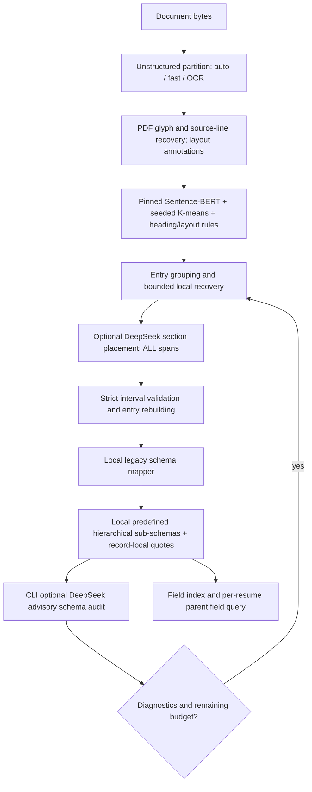

# Architecture audit — preflight, no paid execution

Inspected working tree: HEAD `81968d88` (Improve hierarchical resume schema mapping), followed by `555ea430`, `4320f621`, `3bc4935c`. At entry Git showed only earlier untracked reference/review directories; no tracked production diffs. Implementation fingerprints are frozen in selection-manifest.json. Latest saved development outputs are reports/project-url-fix-20261024/offline-replay/{02,03}/schema.json; bulk baselines are reports/hierarchical-schema-all1541-20261023/final-per-resume.json and document artifacts. These are different generations of output; bulk counts must not be described as latest post-fix semantic results.

## Extraction and evidence

`local_api/services/text_extraction_service.py::extract_text` checks detected file type/content, size, strategy, encrypted PDFs and dependencies, invokes installed Unstructured `partition`, serializes page metadata, and preserves source text. `auto` chooses upstream behavior; `ocr_only` explicitly requests Tesseract; neither every PDF nor every pass gets OCR. `pdf_glyph_recovery.py` uses unique PDF text-layer matches with original/replacement maps; `pdf_section_layout.py` annotates lines; `pdf_source_recovery.py` restores omitted lines and collapses identical text at identical coordinates while retaining original duplicate elements in metadata. PDF enrichment exceptions are caught and warned, so extraction can succeed with less layout/evidence enrichment. Six legacy DOCs previously left pending remain outside this PDF sample.

Source IDs are `e<element_index>:<start>:<end>`. Offsets refer to the finalized extracted inventory, not original PDF byte offsets. `source_validation.py::validate_result` checks exact slices, coverage, overlap and entry references. `source_accounting.py::account_source` independently asserts coverage then classifies assigned, human-review, and non-content artifacts. These establish conservation of extracted text, not original-PDF word accuracy. Page numbers are metadata; they do not certify blank/trailing-page count.

## Local section detection and grouping

`resume_sections.py::SectionEngine` loads local pinned `sentence-transformers/all-MiniLM-L6-v2`, revision `1110a243fdf4706b3f48f1d95db1a4f5529b4d41`, with CPU, local-files-only and no remote code. This is a general BERT encoder, not a resume-fine-tuned block detector. `SemanticClusters` fits anchor-initialized K-means (`n_init=1`, `random_state=42`). Sentence units use tokenizer offsets, heading aliases, PDF-line cuts and word-safe boundaries. Explicit heading context, per-lane layout, contact heuristics, dated-employer boundaries and conflict thresholds materially control final ownership; it is not a pure model decision.

`resume_structure.py::entry_groups`, `source_rows.py::refine_rows`, and `record_relationships.py::annotate_relationships` create record groups and warnings. Conflict/uncertainty can produce `needs_review`. Explicit record labels avoid mistaken new sections. Already assigned text is NOT immutable: local recovery can rerun detection for the whole inventory, and DeepSeek receives all spans and may reassign previously assigned content. Coverage validators protect text conservation, not semantic preservation of correct assignments.

## Recovery and termination

`scripts/check_single_resume.py` extracts, calls `detect_sections`, then `recover_sections`, then delegates to `scripts/single_resume_pipeline.py::run_feedback`. `section_recovery.py::recover_sections` scans unresolved text for strong title-style aliases, adds cuts, and reruns the engine only when cuts were found. It is one bounded local pass per invocation; it does not automatically re-extract missed PDF words.

`run_feedback` actually re-enters local recovery, LLM placement, local mapping and schema audit on subsequent passes. Unresolved meaningful spans, missing required legacy fields and audit findings become feedback. It does not train the model or directly accept audit suggestions as facts. Planned recovery_attempts=1 means at most two passes; each can call placement plus audit, at most four provider calls per document. Invalid-placement retries share that budget. Failure retains validated output; authentication/provider failures stop; unchanged section/data fingerprint stops; clean diagnostics or exhausted budget stops. The fingerprint includes legacy `data` and section intervals/entries, not the full hierarchical output, so hierarchy-only diagnostic changes do not necessarily count as progress. Local-only mode takes one feedback pass and does not exercise paid recovery. All these behaviors require real execution traces before claiming the chosen ten recovered successfully.

## Parent/child mapping

`schema_mapping.py::map_schema` validates supplied source/sections, invokes the vendored handoff helpers and source-local refinement (`record_subfields.py`, `education_subfields.py`, `list_fields.py`). It makes zero provider calls. `section_subschemas.py::build_subschemas` maps each record using only that record's block IDs, produces unresolved attributes and residual blocks, and preserves training/research relationship warnings. `schemas/subschema_spec.py` defines the parent/child registry; `schemas/subschemas.py` requires predefined fields, valid scalar/list cardinality, typed values and nonempty per-item evidence. `subschema_validation.py::validate_hierarchy` verifies exact quotes, value support, correct parent inventories and matching repeated-record ownership.

There is no separate production LLM field mapper in this path. DeepSeek section review can change grouping indirectly; the CLI schema audit is advisory. The API schema endpoint alone does not execute the CLI feedback/audit loop. Legacy and hierarchical representations deliberately can differ: for example invalid-shape legacy names may be withheld from hierarchical fields. Structural compatibility does not guarantee semantic equality, date normalization or correct record grouping. Dates remain source-supported text; do not assume canonical normalized dates or interpret “Present” as an independently current fact.

## Search and query scope

`local_api/routes/schema_mapping.py` exposes `/api/v1/resume/schema/query`: it consumes one source/sections payload, remaps locally, and calls `subschema_validation.py::query_subschemas` with `parent.child` and optional `record_id`. `build_field_index` provides predefined field paths and JSON pointers, including unresolved fields. It preserves record identity and source evidence. It is a real per-resume field lookup, but not a cross-candidate search service. No persistent candidate index, multi-resume predicate engine, ranking or combined candidate skill/experience search interface was found in local_api routes/services. Test existing lookup and record filtering; report candidate search precision/recall unavailable. Recommended later design: index document hash + parent + stable record key + field values + evidence, apply same-record predicates, and preserve uncertainty. This evaluation does not build that system.

## Assessment before execution

The intended source-bound architecture substantially exists, but provider schema mapping and candidate search differ from the intended description. Ten successful JSON outputs cannot certify whole-system accuracy. Section labels exist only for the separate 15-document source-bound benchmark; none of the proposed ten are those pilot documents. The two development controls have only 17 partial expected fields, six of which are prior Manjunath expectations with narrower provenance; A069 is uncertain. Fresh metrics remain pending confirmation and execution. No unreviewed prediction is ground truth.
